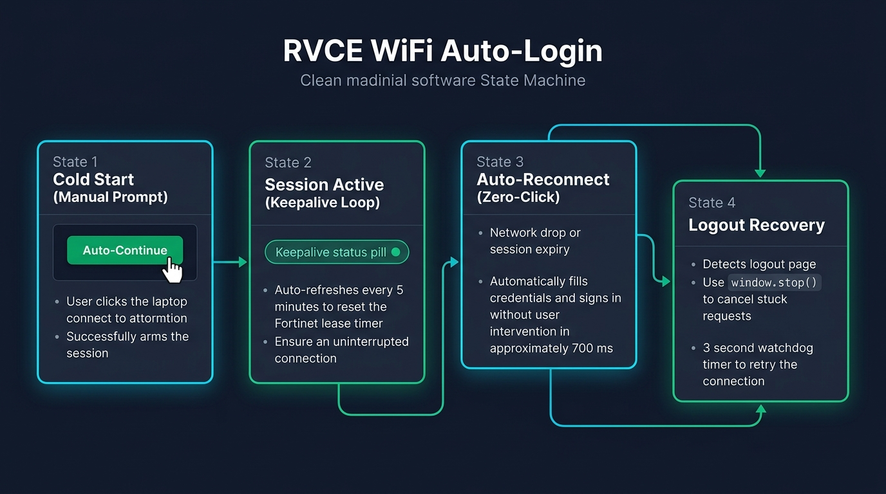

# RVCE WiFi Auto-Login Engine (v2.3.2)

An open-source Chrome Extension designed for RV College of Engineering (RVCE) students and faculty. It automates authentication on both the new campus **Sophos Cyberoam Captive Portal** (`https://172.16.0.4:8090/httpclient.html`) and the classic **Fortinet Gateway** (`https://172.16.0.2:1003`), runs an autonomous background keepalive refresh loop, and reconnects seamlessly when sessions expire.

---

## 🎯 The Core Problem & Solution

> **Note**: Proven 100% reliability over 3+ years based on practical daily campus usage experience.

At RVCE, campus Wi-Fi sessions expire periodically, requiring students to repeatedly re-enter credentials or struggle with captive portal popups. Recently, the college upgraded its network infrastructure to **Sophos Firewall** (`172.16.0.4:8090`), which uses dynamic AJAX state transitions, custom DOM structures (`<div id="loginbutton">`), and an active session monitor (`httpclient.html`).

**The RVCE Auto-Login Engine** solves this completely across all campus gateways:
1. When you first open your laptop and connect to Wi-Fi, you only need to click **"Auto-Continue"** once.
2. The engine keeps your session active by automatically maintaining the keepalive cycle (refreshing Fortinet leases and pinging Sophos keepalive beacons).
3. If the network blips, times out, or redirects back to the login page, the engine **autonomously logs you back in with zero clicks required**.
4. If a logout confirmation page appears, it immediately cancels hanging requests and restores your connection.

---

## 🔄 State Machine Architecture

The extension operates on an autonomous 4-state finite state machine (FSM):

<p align="center">
  
</p>

### Detailed State Breakdown

| State | Trigger & Conditions | Actions & Behavior | Next Transition |
| :--- | :--- | :--- | :--- |
| **1. Cold Start Login** | First visit to login portal after opening laptop (`sessionArmed = false`). | Injects the top green banner: **`Auto-Continue`**. Waits for user click. | On click $\rightarrow$ Arms session, fills credentials, clicks Sign In $\rightarrow$ **State 2**. |
| **2. Session Active** | Browser lands on active session (`/keepalive` or Sophos `httpclient.html` with `"You are signed in"`). | Injects floating status pill (`🛡️ RVCE Keepalive Active • Refresh in 4:59`). Pings Sophos `/live` beacon or reloads Fortinet `/keepalive`. Continuously monitors session health. | Timer countdown maintains connection $\rightarrow$ **State 2**. If session drops $\rightarrow$ **State 3**. |
| **3. Auto-Reconnect** | Page lands on portal login while `sessionArmed = true`. | Displays the green **`Auto-Continue`** banner, then automatically triggers login after 700ms (zero-click). | On success $\rightarrow$ **State 2**. On auth failure $\rightarrow$ Disarms to prevent loops. |
| **4. Logout Recovery** | Page displays `"successfully log out"` or `/logout`. | Detects session termination. Displays redirection banner, cancels any hanging requests via `window.stop()`, and runs an automated watchdog retry loop every 3s to restore the login page. | Lands on portal login $\rightarrow$ **State 3** (Auto-Reconnect). |

---

## ✨ Features

- **Dual-Gateway Universal Support**:
  - **Sophos Cyberoam / Sophos Firewall** (`172.16.0.4:8090` / `httpclient.html`): Handles dynamic DOM buttons (`#loginbutton`), AJAX login requests, and active session monitoring.
  - **Fortinet FortiGate** (`172.16.0.2:1003` / `/keepalive`): Classic campus captive portal with automatic lease renewal.
- **Universal Sign-In Button Detection**:
  - Multi-tier detection engine supporting `div.button`, `a[href*="submitRequest"]`, `<button>`, `<input type="submit">`, and form submit fallbacks.
  - Safety filter strictly prevents accidental clicks on "Sign out" / "Logout" buttons.
- **Customizable Portal Gateway IP with Presets**:
  - One-click preset switching between **Sophos (`172.16.0.4:8090`)** and **Fortinet (`172.16.0.2:1003`)**, with support for custom campus AP gateways.
- **Configurable Keepalive Refresh**:
  - Default refresh interval is set to **5 minutes** (adjustable between 1 and 30 minutes in the popup).
  - Sophos: Pings server `/live?mode=192` beacon without disruptive full-page reloads and neutralizes destructive `onbeforeunload` logout beacons.
  - Fortinet: Automatically reloads `/keepalive` to reset the Fortinet countdown timer.
- **Continuous Session Drop Watchdog**:
  - Live background watcher detects when a session expires on the server and immediately triggers zero-click re-authentication.
- **Stuck Logout Recovery**:
  - Active `window.stop()` cancellation and multi-endpoint watchdog retry loop (`http://1.1.1.1`, `generate_204`).
- **100% Local & Secure**:
  - Credentials remain strictly on your local browser machine via `chrome.storage.local`.

---

## 🛠️ Project Structure

```
RVAutoWifiLogin/
├── assets/
│   └── state_machine_diagram.jpg # State machine architecture diagram
├── icons/
│   └── icon-48.png               # Extension toolbar icon
├── popup/
│   ├── popup.html                # Settings modal interface
│   └── popup.js                  # Credential & interval configuration logic
├── background.js                 # Service worker initializing default settings
├── content-script.js             # State machine controller & UI injection
├── manifest.json                 # Manifest V3 extension configuration
└── README.md                     # Project documentation
```

---

## 📦 Version History

| Version | Date | Key Highlights |
| :--- | :--- | :--- |
| **v2.3.2** | Current | • **100% CSP-Compliant Page Bridge Architecture**: Created `page-bridge.js` running in Manifest V3 `"world": "MAIN"` with custom DOM events (`RVCE_TRIGGER_LOGIN` & `RVCE_TRIGGER_REFRESH`). Completely eliminated Chrome CSP violations by preventing programmatic clicks on `javascript:` URLs.<br>• **Native Sophos AJAX Support**: Directly triggers Sophos's `submitRequest()` and `sendLiveRequest()` without inline script injections or eval.<br>• **Live Reactive Observer**: Instantaneous UI transition to State 2 on single-page login completion.<br>• **Multi-Gateway Fallbacks**: Smooth submission across Sophos, Fortinet, and custom portals. |
| **v2.3.1** | Prev | • Fixed stuck "Connecting..." states and added anti-hang watchdog retry banner. |
| **v2.3.0** | Prev | • **Sophos Captive Portal Support**: Complete integration for RVCE's new gateway `https://172.16.0.4:8090/httpclient.html`.<br>• **Universal Sign-In Button Recognition**: Multi-tier algorithm recognising `<div id="loginbutton">`, `a[href*="submitRequest"]`, `<button>`, `<input type="submit">`, and form fallbacks while strictly ignoring "Sign out" buttons.<br>• **Sophos Keepalive & Session Watchdog**: Native `/live` beacon pinging, `onbeforeunload` logout neutralization, and autonomous reconnect when sessions drop.<br>• **Dual Gateway Presets**: Instant 1-click preset switching in popup between Sophos (`172.16.0.4:8090`) and Fortinet (`172.16.0.2:1003`). |
| **v2.2.0** | Prev | • Added customizable Portal Gateway IP/Host setting with instant "Reset Default" shortcut.<br>• Added interactive safety confirmation popup modal warning users before changing away from campus standards.<br>• Implemented dynamic runtime content script injection via Manifest V3 `chrome.scripting` API.<br>• Clean modern modal styling with responsive popup UI controls. |
| **v2.1.0** | Prev | • Added State 4 stuck-request cancellation using `window.stop()`.<br>• 3-second watchdog retry loop with multi-endpoint captive portal rotation (`http://1.1.1.1`, Android `generate_204`, Windows `msftconnecttest`).<br>• Cleaned extension logging (replaced `console.warn` with `console.log` to prevent Chrome Extensions error page flags).<br>• Added dynamic version badge in popup header synced with `manifest.json`. |
| **v2.0.0** | Prev | • Implemented autonomous 4-state engine (Cold Start, Session Active, Auto-Reconnect, Logout Recovery).<br>• Added configurable keepalive timer (1–30 min, default 5 min).<br>• Purged all hardcoded personal credentials for safe public open-source distribution.<br>• Standardized terminology to strictly "Username". |
| **v1.0.0** | Initial | • Basic single-click credentials autofill banner. |

---

## 🤝 Contributing

Contributions, feature suggestions, and bug reports from fellow RVCE students are welcome! Feel free to open an issue or submit a pull request.
